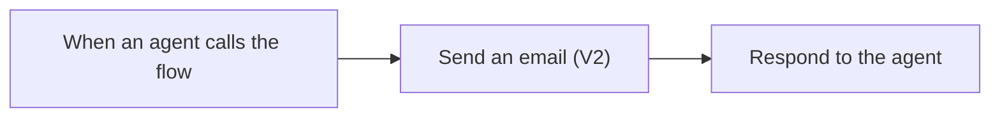

# Exercise 4: Agent flow — สร้างเครื่องมือส่งสรุปที่ตรวจแล้ว ไปทาง email

<ExerciseCover image="04-agent-flow" alt="เตรียมสรุปที่ตรวจแล้วเพื่อส่งไปยัง inbox ทดสอบ" position="60% center" />

เรามีเนื้อหา email จาก Prompt ใน Exercise 3 แล้ว ต่อไปจะสร้าง flow สำหรับส่งเนื้อหานี้ไปยัง inbox ทดสอบ เหมือนบริการส่งจดหมายที่รับที่อยู่ผู้รับและข้อความ แล้วแจ้งกลับเมื่อส่งสำเร็จ

**ผลลัพธ์:** flow ชื่อ Send Reviewed Training Brief ที่มี 3 node เรียงต่อกัน: รับข้อมูล → ส่ง email → ตอบกลับ Agent พร้อมเรียกใช้ผ่านบทสนทนาใน Test panel

> **License:** ต้องตรวจสอบสิทธิ์ Agent flow, publishing และ capacity ใน Copilot Studio รวมถึง Office 365 Outlook connection และ Exchange Online mailbox ของบัญชีที่ใช้

## Prerequisites

- Service Request Assistant และ body ที่ review แล้วจาก Exercise 3
- ผู้สอนกำหนด approved test inbox และอนุญาต Outlook connection สำหรับการฝึกแล้ว

> **สำคัญ:** การทดสอบทั้งใน flow designer และ Test panel ของ Agent อาจส่ง email จริง flow นี้ไม่มีขั้นตอนตรวจผู้รับหรือเนื้อหาอัตโนมัติ ผู้เรียนต้องตรวจว่าใช้ inbox ที่ผู้สอนอนุญาตและเนื้อหาที่ review แล้วก่อนทดสอบทุกครั้ง

---

## Scenario 1: ส่งสรุปที่ตรวจแล้วไปยัง inbox ทดสอบ

เราจะสร้าง flow แบบตรงไปตรงมา โดยไม่เพิ่ม `Compose`, `Condition` หรือ branch แยกเส้นทาง



### Practice 1: สร้าง flow และช่องรับข้อมูล

<PracticeIllustration id="ex04-p01" />

**เป้าหมาย:** สร้าง trigger ที่มีช่องรับ email ผู้รับและเนื้อหา email

#### Steps

1. เลือก Environment เดียวกับ Service Request Assistant
2. เปิดหน้า `Flows`
3. เลือกสร้าง `Agent flow`
4. ตั้งชื่อ flow ตามนี้

   ```text
   Send Reviewed Training Brief
   ```

5. ตรวจว่า node แรกเป็น trigger `When an agent calls the flow`

   หากเป็น trigger อื่น ให้เปลี่ยนเป็นชื่อนี้ก่อนทำขั้นถัดไป

6. เพิ่ม input ชนิด `Text` ใน trigger สำหรับรับ email ผู้รับ
7. ตั้งชื่อ input แรกตามนี้

   ```text
   RecipientEmail
   ```

8. เพิ่ม input ชนิด `Text` อีกหนึ่งช่องสำหรับรับเนื้อหา email
9. ตั้งชื่อ input ที่สองตามนี้

   ```text
   EmailBody
   ```

10. กด `Save draft` เพื่อบันทึก flow ชั่วคราว


#### Checkpoint

Trigger มี input ชนิด Text สองตัว ชื่อ `RecipientEmail` และ `EmailBody` ตรงตามตัวอย่าง ยังไม่ต้องเพิ่ม flow เป็นเครื่องมือในหน้า Tools ของ Agent

---

### Practice 2: เพิ่มขั้นตอนส่ง email

**เป้าหมาย:** นำข้อมูลจาก trigger มาใส่ใน email โดยตรง

#### Steps

1. กดเพิ่ม action ใต้ trigger `When an agent calls the flow`
2. ค้นหา `Office 365 Outlook`
3. เลือก action `Send an email (V2)`
4. เลือก Outlook connection สำหรับฝึกที่ผู้สอนอนุญาต
5. คลิกช่อง `To`
6. คลิกด้านขวาของช่อง `To` ที่เป็นรูปเครื่องหมายฟันเฟือง (⚙️)
7. เลือก `Use dynamic content` (รูปสายฟ้า ⚡) เพื่อเปิดรายการ dynamic content
8. เลือก dynamic content ชื่อ `RecipientEmail` จาก trigger

   Dynamic content คือค่าที่ flow รับมาตอนเริ่มทำงาน ให้เลือกจากรายการ ไม่พิมพ์คำว่า `RecipientEmail` ลงไปในช่องเอง

9. กรอกหัวข้อ email ในช่อง `Subject` ตามนี้

   ```text
   [TRAINING] Service escalation brief
   ```

10. คลิกช่อง `Body`
11. เลือก dynamic content ชื่อ `EmailBody` จาก trigger
12. เปิด `Settings` ของ action `Send an email (V2)`
13. ตั้ง `Retry policy` เป็น `None` หากมีตัวเลือกนี้

    ค่านี้ช่วยไม่ให้ action ลองส่งซ้ำอัตโนมัติ

#### Checkpoint

ใต้ trigger มี action ส่ง email เพียงตัวเดียว ช่อง `To` รับค่าจาก `RecipientEmail` และช่อง `Body` รับค่าจาก `EmailBody` โดยไม่มีขั้นตอนตรวจเงื่อนไขคั่นกลาง

---

### Practice 3: เพิ่มข้อความตอบกลับ Agent

<PracticeIllustration id="ex04-p03" />

**เป้าหมาย:** ให้ flow ตอบกลับหลังขั้นตอนส่ง email ทำงานสำเร็จ

#### Steps

1. เพิ่ม `Respond to the agent` ใต้ action `Send an email (V2)`

   หากมี node นี้อยู่แล้ว ให้ใช้ node เดิมเป็นขั้นตอนสุดท้าย ไม่ต้องเพิ่มซ้ำ

2. เพิ่ม output ชนิด `Text` ใน `Respond to the agent`
3. ตั้งชื่อ output แรกว่า `Status`
4. ใส่ค่าของ `Status` ตามนี้

   ```text
   Sent
   ```

5. เพิ่ม output ชนิด `Text` อีกหนึ่งตัว
6. ตั้งชื่อ output ที่สองว่า `ResponseMessage`
7. ใส่ค่าของ `ResponseMessage` ตามนี้

   ```text
   ส่งสรุปทดสอบแล้ว
   ```
8.  กด `Save draft`
9.  กด `Publish`
10. เช็คว่า flow มีสถานะ Published สมบูรณ์ หากไม่สามารถ publish ได้ให้แจ้งผู้ดูแล
11. ถ้าการ publish สำเร็จ ให้กดปุ่ม `Back to agent` เพื่อเพิ่ม flow เข้า tool ของ Agent

   ⚠️ ถ้ากลับมาที่หน้า Agent > Tools แล้วยังไม่เห็น flow ที่เพิ่ม ให้ทำการกดปุ่ม `+ Add tools` เองและเลือก flow ที่เพิ่ง publish ตามชื่อของเราที่ตั้งไว้

#### Checkpoint

Flow มี 3 node ตามแผนภาพ และมี `Respond to the agent` เพียงตัวเดียว ข้อความ `Sent` จะตอบกลับเมื่อขั้นตอนส่ง email สำเร็จเท่านั้น

> **หากส่งไม่สำเร็จ:** flow นี้จะไม่ตอบกลับว่า `Sent` และไม่มี branch ตอบกลับกรณีล้มเหลว ให้ตรวจข้อผิดพลาดใน Run history และตรวจ mailbox ก่อนตัดสินใจทดสอบใหม่ เพื่อป้องกันการส่งซ้ำ

---

### Practice 4: ทดสอบส่ง email ด้วยตนเอง

<PracticeIllustration id="ex04-p04" />

**เป้าหมาย:** ตรวจว่า flow ส่ง email และตอบกลับได้จริง

#### Steps

1. กดดูเมนู Flow ด้านซ้ายมือ ของ Copilot Studio Portal
2. หา flow ชื่อ `Send Reviewed Training Brief` และกดเพื่อเปิด
3. กดปุ่ม `Edit` ทางด้านบนซ้ายเพื่อเข้าสู่โหมด Designer เพื่อแก้ไข flow
4. กดปุ่ม `Test` ทางด้านบนขวา เพื่อเข้าสู่โหมดทดสอบ flow
5. เลือก `Manually` เพื่อทดสอบ flow ด้วยตนเอง และกดปุ่ม `Test`
6. ตัวอย่างสำหรับทดสอบ:

   ```text
   เรียนทีม Service Operations

   สรุปคำขอ CASE-201:
   - หัวข้อ: ขอความช่วยเหลือในการตรวจสอบบริการ
   - ระดับความสำคัญ: ปานกลาง
   - การดำเนินการ: กรุณาตรวจสอบและแจ้งผลกลับ

   ขอบคุณครับ
   ```
7. ใส่ email ของ inbox ทดสอบที่ผู้สอนอนุญาตในช่อง `RecipientEmail`
8. วางเนื้อหาที่เตรียมไว้ในช่อง `EmailBody`
9.  กดเริ่มทดสอบเพียงหนึ่งครั้ง

10. เปิด Run history ของการทดสอบครั้งนี้
11. ตรวจว่า `Send an email (V2)` มีสถานะการทำงานเป็น Succeed
12. เปิด inbox ทดสอบ ตรวจว่าได้รับ email หนึ่งฉบับจากการทดสอบครั้งนี้


#### Checkpoint

เห็นผลตอบกลับใน Run history และพบ email ใน inbox ทดสอบ

---

## Scenario 2: ให้ Agent เรียก flow เมื่อผู้ใช้ยืนยันส่ง

ต่อไปจะนำ flow มาเป็นเครื่องมือของ Agent แล้วลองจัดรูปแบบและส่ง email ในบทสนทนาเดียวกัน

### Practice 5: ตรวจเครื่องมือและ inputs ใน Agent

**เป้าหมาย:** ให้ Agent รู้ว่าเครื่องมือแต่ละตัวรับข้อมูลอะไร

#### Steps

1. กลับไปเปิด Agent ชื่อ Service Request Assistant
2. เปิดหน้า `Tools`
3. เลือก `Send Reviewed Training Brief`

   หากยังไม่มี ให้กด `Add a tool` หรือ `+ Add tools` ตาม UI ที่เห็น แล้วเลือก flow ชื่อนี้ ไม่ต้องสร้าง flow ใหม่

4. ใส่ Description ของเครื่องมือตามนี้

   ```text
   Sends reviewed email content to a test inbox. Use only when the user explicitly confirms sending and provides the recipient. Do not use for drafting or revising content.
   ```

5. เปิดส่วน `Inputs`
6. ตรวจว่า `RecipientEmail` และ `EmailBody` ใช้ `Fill using` เป็น `Dynamically fill with AI`
7. ใส่ Description ของ `RecipientEmail` ตามนี้

   ```text
   inbox address provided by the user. Ask the user if it is missing. Never invent an address.
   ```

8. ใส่ Description ของ `EmailBody` ตามนี้

   ```text
   The latest email body shown to the user and confirmed. Preserve the exact content.
   ```

9. กด `Save`
10. เปิดเครื่องมือ `Format Service Brief`
11. ตรวจว่า inputs ยังเป็น `CaseNotes` และ `BriefStyle` จาก Exercise 3

#### Checkpoint

หน้า Tools มีทั้งเครื่องมือจัดรูปแบบและเครื่องมือส่ง email โดยแต่ละตัวมี inputs สองตัวตรงตามชื่อที่กำหนด

---

### Practice 6: เพิ่ม Instructions สำหรับเรียก flow

**เป้าหมาย:** ให้ Agent แยกคำขอร่างข้อความออกจากคำขอส่งจริง

#### Steps

1. เปิดหน้า `Overview` ของ Agent
2. เปิดแก้ไข `Instructions`
3. เพิ่มข้อความนี้ต่อท้าย โดยเก็บ Instructions เดิมไว้

   ```text
   ## Sending a reviewed brief
   - Use Send Reviewed Training Brief only when the user confirms that the email body has been reviewed, explicitly requests sending, and provides the approved test inbox.
   - If the recipient is missing, the body is empty, or review has not been confirmed, ask for the missing information first.
   - If the tool fails or returns no result, explain that sending is not confirmed. Ask the user to check Run history and the inbox before trying again.
   ```

4. เลือกข้อความ `Send Reviewed Training Brief` ในเงื่อนไขข้อแรก แล้วลบเฉพาะชื่อเครื่องมือนี้
5. กด `+ Add` ที่ตำแหน่งเดิม
6. เลือกเครื่องมือ `Send Reviewed Training Brief` เพื่อแทรกเป็นการอ้างอิง Tool จริง เหมือนใน Exercise 3
7. กด `Save`

#### Checkpoint

Instructions เดิมยังอยู่ และมีเงื่อนไขใหม่ให้ส่งเฉพาะเมื่อผู้ใช้ยืนยันพร้อมระบุผู้รับที่อนุญาต เงื่อนไขนี้กำกับ Agent แต่ไม่ได้เพิ่มตัวตรวจเงื่อนไขใน flow

---

### Practice 7: ทดลองจัดรูปแบบและส่งผ่าน Test panel

**เป้าหมาย:** เห็น Agent เรียกเครื่องมือถูกตัว พร้อมตรวจผลการส่งจริง

#### Steps

1. เปิด `Test your agent`
2. เริ่ม session ใหม่
3. ส่ง prompt นี้เพื่อเรียกเครื่องมือจัดรูปแบบก่อน

   ```text
   Case ID: CASE-201
   บันทึกวันที่: 2 October 2026
   ผู้ใช้ขอให้ทีมบริการช่วยติดตามคำขอเอกสารที่ส่งผ่านช่องทางดิจิทัล
   ทีมสาขาพบเลขอ้างอิง CASE-201 ในบันทึก แต่ยังไม่มีผลการตรวจสอบระบบ
   ผู้ใช้ขอทราบช่องทางติดตามต่อ
   ยังไม่ทราบวันที่ยื่นคำขอและชนิดเอกสาร

   ใช้ Format Service Brief จัดบันทึกนี้เป็นร่างเนื้อหา email แบบกระชับ (Concise) ให้ฉันตรวจ ยังไม่ต้องส่ง email
   ```

4. เปิด activity ของการทดสอบเพื่อดู Tool call
5. ตรวจว่าเรียก `Format Service Brief`
6. ตรวจว่ายังไม่มีการเรียก `Send Reviewed Training Brief`

7. คัดลอก prompt นี้ แล้วแทน `[ใส่ email ที่ผู้สอนกำหนด]` ด้วย inbox เดียวกับใน Instructions

   ```text
   ส่งเนื้อหาฉบับนี้ ไปที่ [ใส่ email ที่ผู้สอนกำหนด] เพียงหนึ่งครั้ง
   ```

8. ส่ง prompt ที่แก้แล้วใน session เดิม
9.  ตรวจ activity ว่ามีการเรียก `Send Reviewed Training Brief` หนึ่งครั้ง
10. ตรวจ input `RecipientEmail` ว่าตรงกับ inbox ที่อนุญาต
11. ตรวจ input `EmailBody` ว่าตรงกับร่างฉบับที่ตรวจแล้ว
12. ตรวจผลของเครื่องมือว่า `Status` เป็น `Sent` และมี `ResponseMessage`
13. เปิด Run history ของ flow เพื่อตรวจว่ารอบที่ Agent เรียกส่ง email สำเร็จ
14. เปิด inbox ทดสอบเพื่อตรวจ email ใหม่หนึ่งฉบับ โดยเทียบผู้รับ หัวข้อ และเนื้อหากับรอบนี้


#### Checkpoint

คำขอแรกเรียกเฉพาะเครื่องมือจัดรูปแบบ คำขอยืนยันส่งจึงเรียก flow เห็น inputs และผลตอบกลับจริง พร้อม email ที่ตรงกับเนื้อหาที่ตรวจแล้ว ไม่ใช้เพียงข้อความตอบของ Agent เป็นหลักฐานว่าส่งสำเร็จ

## Expected Output

- Flow ชื่อ `Send Reviewed Training Brief` ที่มีเพียง trigger → ส่ง email → ตอบกลับ Agent
- Inputs ชนิด Text ชื่อ `RecipientEmail` และ `EmailBody`
- Outputs ชนิด Text ชื่อ `Status` และ `ResponseMessage`
- หลักฐานการทดสอบจาก Tool call, Run history และ email ที่ได้รับจริง
- Flow เป็น Published และเพิ่มเป็นเครื่องมือในหน้า Tools ของ Agent แล้ว
- Instructions ที่แยกการจัดรูปแบบออกจากการส่ง และเรียก flow เมื่อผู้ใช้ยืนยันส่งไปยัง inbox ที่อนุญาต

## Summary และสิ่งที่จะใช้ต่อ

เราสร้าง flow แบบ 3 node และทดสอบทั้งใน flow designer และผ่าน Agent แล้ว ผู้เรียนตรวจเนื้อหาและยืนยันผู้รับก่อนให้ Agent ส่ง ใน Exercise 5 จะใช้ Agent ตัวเดิมลอง Topic แบบหนึ่งคำถามสองตัวเลือก เพื่อให้คำแนะนำเรื่องการตรวจสรุป CASE-201 กิจกรรมนั้นไม่มีการเรียก flow หรือส่ง email ครับ

[กลับสารบัญ](/) | [Exercise 5: Topics](/exercises/05-topics)
