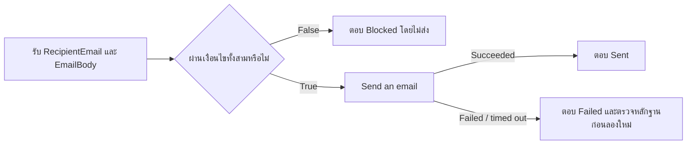

# Exercise 4: Agent flow — สร้างเครื่องมือส่งสรุปที่ตรวจแล้ว

<ExerciseCover image="04-agent-flow" alt="ตรวจซองสรุปและถาดปลายทางที่อนุญาตก่อนผ่านจุดส่งเอกสาร" position="60% center" />

เรามี email body จาก Prompt ใน Exercise 3 แล้ว ต่อไปจะสร้าง flow ที่รับผู้รับกับ body และส่งไปยัง inbox ทดสอบที่กำหนด เหมือนเตรียมบริการจัดส่งที่รับซองซึ่งตรวจแล้ว ส่วน Exercise 5 จะใช้สถานการณ์เดิมเพื่อรู้จัก Topic ที่ถามสถานะการตรวจสรุปและให้คำแนะนำครับ

**ผลลัพธ์:** flow ชื่อ Send Reviewed Training Brief ที่มี input สองตัว พร้อมทดสอบด้วยตนเองใน flow designer

> **License:** ต้องตรวจสอบสิทธิ์ Agent flow, publishing และ capacity ใน Copilot Studio รวมถึง Office 365 Outlook connection และ Exchange Online mailbox ของบัญชีฝึก Native Agent flow ไม่ได้ต้องมี Power Automate license แยกเพียงเพราะใช้ flow แต่สิทธิ์และ capacity ที่เกี่ยวข้องต้องพร้อม

## Prerequisites

- Service Request Assistant และ body ที่ review แล้วจาก Exercise 3
- ผู้สอนกำหนด approved test inbox และอนุญาต Outlook connection สำหรับการฝึกแล้ว
- <DownloadFile file="test-log.csv">Test log</DownloadFile> สำหรับบันทึกผลจริง

> **Note:** การกด Test ใน flow designer อาจส่ง email จริง ให้ใช้เฉพาะ body ที่ตรวจแล้วและ inbox ที่ได้รับอนุญาต การทดสอบตรงนี้เป็นการสั่งทดสอบโดยผู้เรียนเอง ยังไม่ใช่เส้นทางบทสนทนาของ Agent

---

## Practice 1: กำหนดสิ่งที่ flow ต้องรับ

<PracticeIllustration id="ex04-p01" />

**Primary target:** สร้าง flow ที่รับผู้รับและ body ได้อย่างชัดเจน

1. เปิดหน้า `Flows` แล้วเลือกสร้าง `Agent flow` ใน Environment เดียวกับ Agent ไม่สร้างผ่านการเพิ่มเป็น agent-level tool
2. ตั้งชื่อ

   ```text
   Send Reviewed Training Brief
   ```

3. ตรวจว่ามี trigger `When an agent calls the flow` หากได้ trigger ชนิดอื่น ให้เปลี่ยนให้ตรงก่อนเพิ่ม Text inputs ทีละตัว

   - **ผู้รับ**

     ```text
     RecipientEmail
     ```

   - **เนื้อหาที่ review แล้ว**

     ```text
     EmailBody
     ```

4. ตรวจว่าไม่มี input สำหรับ Subject หรือ Confirmation เราจะกำหนด Subject ใน send action การกด Test เป็นคำสั่งทดสอบโดยผู้เรียนหลัง review และได้รับอนุญาต
5. หาก designer สร้าง `Respond to the agent` ตั้งต้นไว้ ให้ย้ายไปใช้เป็น success response หลัง send action ใน Practice 3 อย่าปล่อย response เพิ่มไว้นอก Condition เพราะอาจตอบก่อนทราบผลจริง

### Checkpoint

Flow มี input สองตัวและชื่อถูกต้อง จดชื่อ flow ไว้สำหรับตรวจ Run history และหลักฐานการทดสอบ

---

## Practice 2: ตรวจปลายทางและเนื้อหาก่อนส่ง

<PracticeIllustration id="ex04-p02" />

**Primary target:** บล็อกผู้รับที่ไม่ตรงกับ inbox ที่อนุญาตและ body ที่ว่าง



1. เพิ่ม `Compose` แล้วตั้งชื่อ action

   ```text
   ApprovedTestInbox
   ```

2. ใน Inputs ใส่ approved test inbox ที่ผู้สอนให้เป็นค่าคงที่ ตรวจว่าพิมพ์ครบ ไม่มีช่องว่าง และไม่ใช่ placeholder เก็บอีเมลนี้เฉพาะใน Environment ฝึกกับโน้ตส่วนตัว
3. เพิ่ม `Compose` อีกตัว ตั้งชื่อ action แล้วเลือก dynamic content `EmailBody` จาก trigger เป็น Inputs

   ```text
   EmailBodyRaw
   ```

4. เพิ่ม `Condition` แบบ AND จำนวนสามแถว เลือก dynamic content จริง ไม่พิมพ์ชื่อตัวแปรลงในช่องค่า

   | แถว | ค่าซ้าย | เงื่อนไข | ค่าขวา |
   |---|---|---|---|
   | 1 | RecipientEmail จาก trigger | is equal to | Outputs ของ ApprovedTestInbox |
   | 2 | Outputs ของ ApprovedTestInbox | is not equal to | เว้นว่าง |
   | 3 | ผล Expression ในขั้นถัดไป | is equal to | Boolean false |

5. สำหรับค่าซ้ายของแถว 3 เปิด Expression แล้ววางข้อความนี้

   ```text
   empty(trim(outputs('EmailBodyRaw')))
   ```

6. ค่าขวาแถว 3 ให้ใช้ Boolean ผ่าน Expression ไม่ใช้ข้อความที่มีเครื่องหมายคำพูด

   ```text
   false
   ```

7. ใน branch `False` เพิ่ม `Respond to the agent` ตั้ง Text outputs สองตัวดังนี้

   - **Status**

     ```text
     Blocked
     ```

   - **ResponseMessage**

     ```text
     ยังไม่ได้ส่ง: ตรวจ inbox ทดสอบและ body ที่ review แล้ว
     ```

### Checkpoint

เฉพาะ branch True ที่จะไปส่ง email ผู้รับต้องตรงค่าที่กำหนด และ body ต้องมีข้อความ การฝึกนี้ไม่เพิ่มขั้นตอนปรับตัวพิมพ์หรือช่องว่างของอีเมล ให้คัดลอก approved address ตามที่ผู้สอนกำหนด

---

## Practice 3: ส่งข้อความและคืนผลจริง

<PracticeIllustration id="ex04-p03" />

**Primary target:** ให้ flow คืนสถานะตามผลของ send action

1. ใน branch `True` เพิ่ม `Office 365 Outlook` > `Send an email (V2)` แล้วใช้ connection ฝึกที่ได้รับอนุญาต
2. ตั้งช่องต่าง ๆ ดังนี้

   - **To:** เลือก Outputs ของ `ApprovedTestInbox` ไม่ใช้ค่าที่โมเดลเสนอโดยตรง
   - **Subject:** กรอกค่าคงที่นี้

     ```text
     [TRAINING] Service escalation brief
     ```

   - **Body:** เลือก dynamic content `EmailBody` จาก trigger เพื่อส่งฉบับเดิมที่ตรวจแล้ว ไม่ใช้ค่าที่ถูก trim แทน

3. เปิด Settings ของ send action ตั้ง `Retry policy` เป็น `None` หากมีตัวเลือกนี้ ผู้สอนช่วยยืนยันค่าจริง
4. ใต้ send action เพิ่ม `Respond to the agent` หรือใช้ response ตั้งต้นที่ย้ายมา ให้ทำงานเมื่อ send succeeded ตั้ง Text outputs ชื่อ `Status` และ `ResponseMessage`

   - **Status**

     ```text
     Sent
     ```

   - **ResponseMessage**

     ```text
     ส่งสรุปทดสอบแล้วไปยัง inbox ที่ได้รับอนุญาต
     ```

5. ทำตามตัวอย่างของผู้สอนเพื่อเพิ่ม failure response เป็น parallel branch หลัง send action โดย `Configure run after` เลือกเฉพาะ failed และ timed out ของ send action ไม่ให้ทำงานหลัง success ตั้ง Text outputs ชื่อเดิมทั้งสองตัว

   - **Status**

     ```text
     Failed
     ```

   - **ResponseMessage**

     ```text
     ยังยืนยันการส่งสำเร็จไม่ได้ กรุณาตรวจ Run history และ mailbox ก่อนลองใหม่
     ```

6. ตรวจว่าทุก response ใช้ชื่อและชนิด outputs ตรงกัน ตั้ง `Settings` > `Networking` > `Asynchronous response` เป็น `Off` ทุก response แล้ว `Save draft` และ `Publish`

### Checkpoint

มี send action เดียว ผล Sent เกิดหลัง success เท่านั้น และ failure response ไม่อ้างว่าส่งสำเร็จ ผู้สอนช่วยตรวจ run-after ก่อนทดสอบ

---

## Practice 4: ทดสอบ flow และเก็บหลักฐาน

<PracticeIllustration id="ex04-p04" />

**Primary target:** ยืนยัน input และผลจริงของการทดสอบ flow ด้วยตนเอง

1. ตรวจว่า body มาจากฉบับที่ review แล้วและได้รับอนุญาตให้ทดสอบส่ง จากนั้นเปิด `Test` ใน flow designer
2. ใส่ approved test inbox ใน `RecipientEmail` และวาง body จาก Exercise 3 ใน `EmailBody` แล้วสั่งทดสอบหนึ่งครั้ง
3. ตรวจ Run history และ mailbox เทียบผู้รับ Subject และ body กับ input บันทึก T09 ต้องเห็น email หนึ่งฉบับสำหรับการสั่งทดสอบนี้
4. ทดสอบ destination guard โดยใช้ค่าต่อไปนี้แทนผู้รับ แต่คง body เดิม

   ```text
   blocked@example.invalid
   ```

5. ตรวจว่าได้ `Blocked` และ send action ไม่ถูกเรียก บันทึก T05 แยกจากการส่งที่อนุญาต
6. ให้ผู้สอนตรวจกรณี body ว่าง/มีแต่ช่องว่างและ failure handling ตาม T06–T07 หากไม่ได้รันด้วยตนเองให้บันทึกว่าเป็น instructor evidence หรือ Not run
7. จดชื่อ flow, Environment, inputs `RecipientEmail` / `EmailBody` และ outputs `Status` / `ResponseMessage` ตรวจว่า flow เป็น Published และยังไม่ได้เพิ่มเป็น agent-level tool

### Checkpoint

มีหลักฐาน input สองตัว ผลตอบกลับ และ mailbox ตามที่รันจริง การดูชื่อ flow หรือสถานะ Published อย่างเดียวไม่ยืนยันการส่งสำเร็จ

## Summary และสิ่งที่จะใช้ต่อ

เราสร้างและทดสอบบริการส่งด้วยตนเองแล้ว ใน Exercise 5 จะเปิด Agent ตัวเดิมและลอง Topic แบบหนึ่งคำถามสองตัวเลือก เพื่อให้คำแนะนำเรื่องการตรวจสรุป CASE-201 กิจกรรมนั้นไม่มีการเรียก flow หรือส่ง email ครับ

[กลับสารบัญ](/) | [Exercise 5: Topics](/exercises/05-topics)
