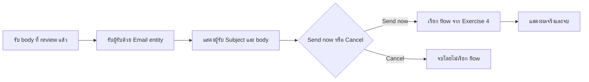

# Exercise 5: Topics — เชื่อมบทสนทนากับ flow ที่เราสร้าง

<ExerciseCover image="05-topics" alt="เจ้าหน้าที่ทบทวนซองสรุปร่วมกันและเลือกยืนยันหรือยกเลิกก่อนส่งต่อไปยังถาดเดิม" position="50% center" />

Flow จาก Exercise 4 ส่งข้อความได้แล้ว เราจะเพิ่มจุดรับเรื่องให้ Service Request Assistant ถามข้อมูล แสดงตัวอย่าง และรอคำยืนยันก่อนเรียก **Send Reviewed Training Brief ตัวเดิม** เหมือนจุดรับพัสดุที่ตรวจซองกับผู้ส่งก่อนส่งต่อให้บริการจัดส่งครับ

**ผลลัพธ์:** Topic ที่รับเนื้อหาฉบับ review แล้วกับผู้รับ เรียก flow เดิมเมื่อเลือก Send now และหยุดเมื่อเลือก Cancel

> **License:** ต้องตรวจสอบสิทธิ์ Topics, การเรียก published Agent flow และ Outlook connection ตาม Exercise 4 ก่อนเริ่มอบรม

## Prerequisites

- Service Request Assistant จาก Exercises 1–3 และ body ฉบับที่ review แล้ว
- Flow จาก Exercise 4 เป็น Published ใน Environment เดียวกับ Agent มี inputs `RecipientEmail` / `EmailBody` และ outputs `Status` / `ResponseMessage`
- ผู้สอนเตรียม Topic skeleton ชื่อ Review and Send ให้ใน Agent ผ่านวิธี import/copy ที่ตรวจแล้ว ใช้ skeleton ของแต่ละคนโดยยังไม่มี action ที่ผูกกับ flow ของคนอื่น
- approved test inbox และ <DownloadFile file="test-log.csv">Test log</DownloadFile>

> **Note:** หากยังไม่มี skeleton ให้แจ้งผู้สอนก่อนเริ่ม ไฟล์คู่มือนี้ไม่ใช่ solution export ที่ import เข้า tenant ได้



---

## Practice 1: กำหนดวิธีเก็บข้อมูลใน Topic

**Primary target:** ให้ Question nodes เก็บ body และอีเมลลงตัวแปรที่ใช้เรียก flow ได้

1. เปิด Agent ตัวเดิม ไปที่ `Topics` แล้วเปิด skeleton ที่ผู้สอนเตรียม

   ```text
   Review and Send
   ```

2. อ่าน Trigger: ใช้เมื่อผู้ใช้ต้องการ review และส่งสรุปทดสอบ หากเป็น phrase trigger ให้ใช้ข้อความนี้ หากเป็น generative trigger ให้ผู้สอนช่วยตรวจว่า Description สื่อเจตนาเดียวกัน

   ```text
   review และส่งสรุปทดสอบ
   ```

3. เปิด Question รับ body แก้ข้อความคำถาม

   ```text
   วาง email body ฉบับล่าสุดที่ตรวจแล้ว ใช้ข้อมูลสมมติเท่านั้น
   ```

4. ตั้ง `Identify` เป็น `User's entire response` แล้วตั้ง `Save user response as` ให้เป็นตัวแปร Topic ชื่อ

   ```text
   EmailBody
   ```

5. เปิด Question ถัดไป แก้ข้อความคำถาม

   ```text
   กรอกอีเมลทดสอบที่ผู้สอนอนุญาต
   ```

6. ตั้ง `Identify` เป็น prebuilt entity `Email` แล้วตั้งชื่อตัวแปร Topic

   ```text
   RecipientEmail
   ```

7. เปิด Properties ของ Question ทั้งสอง ตรวจ `Skip behavior` เป็น `Ask every time` เพื่อใช้ข้อมูลฉบับใหม่ ไม่ข้ามเพราะมีค่าเก่า

### Checkpoint

แสดงตัวแปร `Topic.EmailBody` และ `Topic.RecipientEmail` ได้ การรู้จำ Email ตรวจชนิดข้อมูล ส่วนการอนุญาตปลายทางยังเป็นหน้าที่ guard ใน flow

---

## Practice 2: แสดงสิ่งที่ผู้ใช้กำลังจะยืนยัน

**Primary target:** ทำให้ผู้ใช้เห็นผู้รับและข้อความฉบับที่จะส่งก่อนเลือก

1. เปิด Message สำหรับ preview ใช้ Insert variable เลือก `Topic.RecipientEmail` และ `Topic.EmailBody` แสดงพร้อมป้ายผู้รับและเนื้อหา ห้ามพิมพ์ชื่อตัวแปรเป็นข้อความธรรมดา
2. แสดง Subject คงที่ซึ่งต้องตรงกับ Exercise 4

   ```text
   [TRAINING] Service escalation brief
   ```

3. เปิด Question ยืนยัน ใช้ `Identify` เป็น `Multiple choice options` ตั้งตัวแปร Topic ชื่อ

   ```text
   ReviewChoice
   ```

4. ใช้คำถามต่อไปนี้ และตั้ง `Skip behavior` เป็น `Ask every time`

   ```text
   ตรวจผู้รับและ body ข้างต้นแล้ว ต้องการส่งหรือยกเลิก หากต้องแก้ให้เลือก Cancel ก่อน
   ```

5. ตรวจ options ให้มีสองค่า โดยแต่ละค่าเป็นหนึ่งตัวเลือก

   - **ตัวเลือกส่ง**

     ```text
     Send now
     ```

   - **ตัวเลือกยกเลิก**

     ```text
     Cancel
     ```

6. ตรวจ branch `Cancel` ให้แสดงข้อความนี้แล้ว `End all topics` โดยไม่มี tool call

   ```text
   ยกเลิกแล้ว ยังไม่ได้ส่ง email หากต้องแก้ body ให้แก้ในโน้ตแล้วเริ่ม review ใหม่
   ```

7. ตรวจว่าคำตอบที่ไม่ตรงกับตัวเลือกจะถามใหม่หรือจบโดยไม่เรียก flow ไม่ใช้ other/default branch เป็นทางส่ง

### Checkpoint

ผู้ใช้เห็นผู้รับ Subject และ body ก่อนยืนยัน และ Cancel จบก่อนเรียก action

---

## Practice 3: เลือก flow จาก Exercise 4 และ map ตัวแปร

**Primary target:** ให้ Topic เรียก flow เดิมด้วยค่าที่ผู้ใช้ตรวจแล้ว

1. ใน branch `Send now` เลือก `Add node` > `Add a tool` แล้วเลือก flow ที่เราสร้างไว้

   ```text
   Send Reviewed Training Brief
   ```

2. ตรวจ Environment และชื่อ หากหาไม่พบให้ตรวจว่า flow เป็น Published และมี trigger/response ตาม Exercise 4 ไม่สร้าง flow ใหม่แทนและไม่เพิ่ม sending flow เป็น agent-level tool
3. ใช้ตัวเลือก dynamic content/variable map inputs ดังนี้

   | Input ของ flow | ตัวแปรจาก Topic |
   |---|---|
   | RecipientEmail | Topic.RecipientEmail |
   | EmailBody | Topic.EmailBody |

4. Map outputs `Status` และ `ResponseMessage` เป็นตัวแปร Topic ชื่อดังนี้ตามลำดับ

   - **ตัวแปรสถานะ**

     ```text
     SendStatus
     ```

   - **ตัวแปรข้อความตอบกลับ**

     ```text
     ResponseMessage
     ```

5. เพิ่ม Message แสดง `Topic.SendStatus` และ `Topic.ResponseMessage` ผ่าน Insert variable แล้ว `End all topics` ไม่เขียนข้อความสำเร็จแบบตายตัว
6. ใน Instructions ของ Agent เพิ่มกติกาต่อไปนี้ แล้ว `Save` Agent และ Topic

   ```text
   When the user explicitly asks to review and send a training brief, use the Review and Send topic.
   Only that topic may call Send Reviewed Training Brief after displaying the current body and recipient and collecting Send now.
   Cancel means no sending-flow call. Formatting and revision never send email.
   Report the actual flow result. Never claim success after a blocked, failed, or uncertain run; do not retry uncertain sends automatically.
   ```

7. ตรวจใน Agent ว่า Prompt tool ยังใช้ได้ตาม Exercise 3 แต่ sending flow ใช้ผ่าน Topic นี้เท่านั้น เทียบกับ <DownloadFile file="agent-5-instructions.txt">Instructions หลัง Exercise 5</DownloadFile> หาก skeleton ถูกปิดไว้ ให้ผู้สอนตรวจ mappings และ branches ก่อนเปิดใช้งาน Topic สำหรับทดสอบ

### Checkpoint

ชี้ได้ว่า action node เรียก flow ตัวเดิมจาก Exercise 4 และค่าที่ส่งมาจาก Topic variables ไม่ใช่ค่าตัวอย่างที่พิมพ์ค้างไว้

---

## Practice 4: ทดลองเส้นทางที่เชื่อมกัน

**Primary target:** ตรวจว่าการยืนยันในบทสนทนาควบคุมการเรียก flow จริง

1. เริ่ม test session ใหม่ ใช้ Prompt จัด Case notes 03 ตาม Exercise 3 ตรวจ body แล้วเก็บฉบับล่าสุด
2. ส่งข้อความเพื่อเข้า Topic

   ```text
   review และส่งสรุปทดสอบ
   ```

3. วาง body ที่ตรวจแล้วและ approved test inbox ตรวจ preview แล้วเลือก `Send now`
4. ตรวจ Topic activity, Run history ของ flow **ตัวเดิม** และ mailbox ต้องมีหนึ่งฉบับสำหรับการยืนยันนี้ เนื้อหาตรง preview บันทึก T02 แยกจาก designer test ใน Exercise 4
5. เริ่ม session ใหม่ ทำซ้ำแต่เลือก `Cancel` ตรวจว่าไม่มี flow call และไม่มี email เพิ่มสำหรับกรณีนี้ บันทึก T04
6. หากต้องแก้ body ให้ Cancel ก่อน แก้ในโน้ต เริ่ม review ใหม่ แล้วตรวจฉบับใหม่ก่อน Send now กรณีนี้ใช้ทดสอบ T03 เมื่อผู้สอนให้ดำเนินการ
7. บันทึก gap อย่างน้อยหนึ่งสิ่งที่ยังต้องแก้หรือทดสอบ หากไม่มีหลักฐานให้ระบุ `Not run` หรือ `Blocked` ไม่เติม Pass ให้การทดสอบที่ยังไม่ได้ทำ

### Checkpoint

อธิบายเส้นทาง Prompt → body ที่ review แล้ว → Topic variables → flow inputs → ผลจริงได้ พร้อมหลักฐาน Send now และ Cancel ตามที่รัน

## Summary

Agent ตัวเดียวมี Instructions, Knowledge, Prompt tool และ Topic ที่เรียก flow อย่างชัดเจน การรู้จำ entity ช่วยรับข้อมูล การ review ช่วยตรวจเนื้อหา และ guard ใน flow ช่วยตรวจปลายทาง แต่ละส่วนมีหน้าที่ที่ตรวจแยกกันได้

[กลับสารบัญ](/) | [ทบทวนหลักฐานและ gap](/resources/readiness-worksheet.md)
